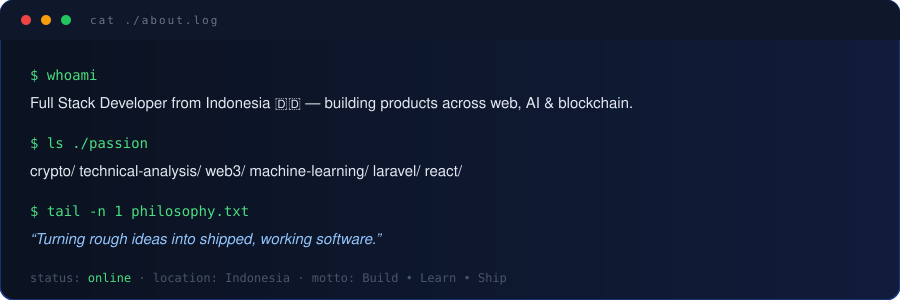
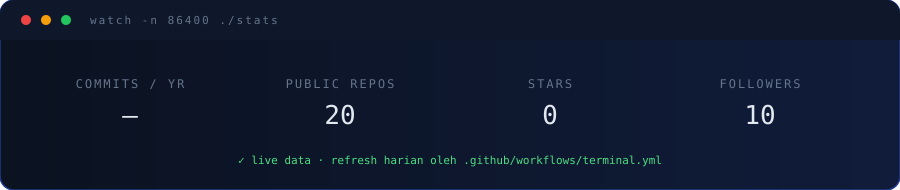
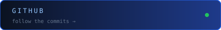

<!--
   ╭──────────────────────────────────────╮
   │  >_  oh, hi. kamu membuka source.    │
   ╰──────────────┬───────────────────────╯
                  │
   ACHIEVEMENT UNLOCKED · SOURCE READER

   how the stats work (no fake numbers):
     semua angka di assets/stats.svg diambil dari GitHub API
     oleh .github/workflows/terminal.yml + scripts/build.mjs
     kalau API gagal, angkanya tetap "—" — bukan karangan.

   this file is hand-written. edit langsung, atau regenerate stats
   lewat tab Actions -> Refresh Terminal Stats -> Run workflow.
-->

<a name="top"></a>

<div align="center">
  
</div>

<p align="center">
  <a href="#about"></a>
  <a href="#loadout"></a>
  <a href="#positions"></a>
  <a href="#chart"></a>
  <a href="#contact"></a>
</p>

<p align="center">
  <b>Full Stack Developer</b> from Indonesia, building web apps, ML experiments and market tooling.<br>
  <sub>PHP · Laravel · Python · React · TensorFlow · Solidity · currently deep in crypto TA &amp; Web3</sub>
</p>

<a name="about"></a>



<a name="loadout"></a>



<a name="positions"></a>


<p align="center">
  <a href="https://github.com/Gilgamesh88888?tab=repositories"></a>
  <a href="https://github.com/Gilgamesh88888?tab=repositories"></a>
</p>

<p align="center">
  <a href="https://github.com/Gilgamesh88888?tab=repositories"></a>
</p>

<a name="chart"></a>



<!-- 🐍 The chart section: animasi ular yang "makan" kotak kontribusi.
     Butuh GitHub Action: simpan snake.yml di .github/workflows/ (lihat PANDUAN di repo),
     set Settings -> Actions -> Workflow permissions -> "Read and write",
     lalu jalankan sekali dari tab Actions -> Run workflow. -->
<p align="center">
  <picture>
    <source media="(prefers-color-scheme: dark)" srcset="https://raw.githubusercontent.com/Gilgamesh88888/Gilgamesh88888/output/github-contribution-grid-snake-dark.svg"/>
    <source media="(prefers-color-scheme: light)" srcset="https://raw.githubusercontent.com/Gilgamesh88888/Gilgamesh88888/output/github-contribution-grid-snake.svg"/>
    
  </picture>
</p>

<a name="contact"></a>



<p align="center">
  <a href="https://github.com/Gilgamesh88888"></a>
  <a href="https://github.com/Gilgamesh88888?tab=followers"></a>
</p>

<a href="SECRET.md"></a>

<details>
<summary><code>$ open terminal</code></summary>

```console
agil@terminal:~$ whoami
agil — full stack developer · ai/ml · crypto & markets

agil@terminal:~$ cat motto.txt
BUILD • LEARN • SHIP
secondary: Manners Maketh Man.

agil@terminal:~$ ls ./currently
building_fullstack_apps/   deep_diving_ai_ml/   charting_crypto_markets/

agil@terminal:~$ cat watchlist.txt
BTC  ETH  ...dan chart lain yang lagi trending hari ini.

agil@terminal:~$ sudo hire agil
[sudo] password for recruiter: ********
✓ permission granted — kembali ke SAVE POINT di atas

agil@terminal:~$ exit
logout — sampai jumpa di chart berikutnya 📈
```

<kbd>↑</kbd> <kbd>↑</kbd> <kbd>↓</kbd> <kbd>↓</kbd> <kbd>←</kbd> <kbd>→</kbd> <kbd>←</kbd> <kbd>→</kbd> <kbd>B</kbd> <kbd>A</kbd>
<sub>&nbsp; cheat diterima: +30 lives. sayangnya, bug juga respawn.</sub>

</details>

<p align="right"><a href="#top"><sub>▲ back to boot screen</sub></a></p>
