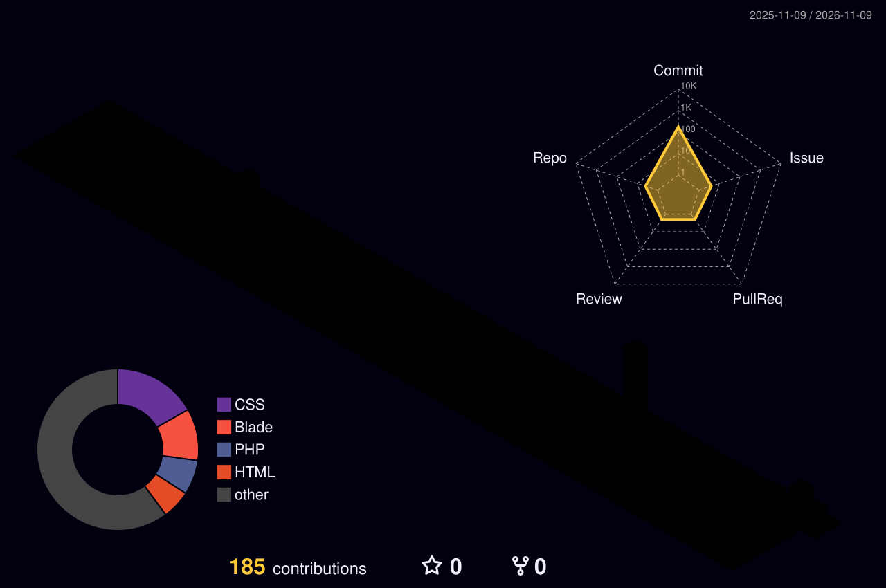

# Hi, I'm **Agil Syeh Febukhori** 

### Full Stack Developer • AI & Machine Learning • Crypto & Market Analysis

---

## 🚀 About Me

I'm a <strong>Full Stack Developer</strong> from <strong>Indonesia 🇮🇩</strong> who enjoys building impactful digital products and exploring the intersection of <strong>software engineering, AI, and blockchain</strong>. 
I'm passionate about turning ideas into real solutions, continuously learning new technologies, and sharpening my analytical mindset through <strong>crypto, technical analysis, and Web3 exploration</strong>.

  

|  |  |
|:--|:--|
| **👤 Name** | Agil Syeh Febukhori |
| **📍 Location** | Indonesia 🇮🇩 |
| **💼 Role** | Full Stack Developer |
| **🎯 Focus** | AI • Machine Learning • Blockchain |
| **🔥 Passion** | Crypto • Technical Analysis • Web3 |
| **🔭 Currently** | Building full-stack apps & exploring Web3 |
| **💬 Ask Me About** | PHP • Laravel • Python • Crypto TA |
| **⚡ Motto** | *Build • Learn • Ship* |

---

## 🛠️ Tech Stack

<table align="center">
  <tr>
    <th align="center" width="160">Languages</th>
    <td align="center">
      
    </td>
  </tr>
  <tr>
    <th align="center" width="160">Frameworks</th>
    <td align="center">
      
    </td>
  </tr>
  <tr>
    <th align="center" width="160">Databases</th>
    <td align="center">
      
    </td>
  </tr>
  <tr>
    <th align="center" width="160">Tools</th>
    <td align="center">
      
    </td>
  </tr>
</table>

---

## 🤖 AI & Machine Learning

  
  
  
  

---

## 💹 Crypto & Market Analysis

  
  
  
  
  
  

---

## 📊 GitHub Analytics

  <picture>
    <source media="(prefers-color-scheme: dark)" srcset="https://streak-stats.demolab.com?user=Gilgamesh88888&theme=tokyonight&hide_border=true&background=0F172A"/>
    <source media="(prefers-color-scheme: light)" srcset="https://streak-stats.demolab.com?user=Gilgamesh88888&theme=tokyonight&hide_border=true"/>
    
  </picture>

<!-- ⚠️ Catatan: layanan stats berikut sedang down (deployment paused) per Nov 2025.
     Kalau sudah normal lagi, hapus tanda pembuka komentar di baris ini dan tanda
     penutupnya di akhir blok untuk mengaktifkan stats card, activity graph, dan trophies.

  <picture>
    <source media="(prefers-color-scheme: dark)" srcset="https://github-readme-stats.vercel.app/api?username=Gilgamesh88888&show_icons=true&theme=tokyonight&hide_border=true&bg_color=0F172A&icon_color=60A5FA&title_color=60A5FA&text_color=C9D1D9&include_all_commits=true&count_private=true"/>
    <source media="(prefers-color-scheme: light)" srcset="https://github-readme-stats.vercel.app/api?username=Gilgamesh88888&show_icons=true&hide_border=true&include_all_commits=true&count_private=true"/>
    
  </picture>
  <picture>
    <source media="(prefers-color-scheme: dark)" srcset="https://github-readme-stats.vercel.app/api/top-langs/?username=Gilgamesh88888&layout=compact&theme=tokyonight&hide_border=true&bg_color=0F172A&title_color=60A5FA&text_color=C9D1D9"/>
    <source media="(prefers-color-scheme: light)" srcset="https://github-readme-stats.vercel.app/api/top-langs/?username=Gilgamesh88888&layout=compact&hide_border=true"/>
    
  </picture>

  <picture>
    <source media="(prefers-color-scheme: dark)" srcset="https://github-readme-activity-graph.vercel.app/graph?username=Gilgamesh88888&theme=tokyo-night&hide_border=true&bg_color=0F172A&color=60A5FA&line=2563EB&point=ffffff&area=true"/>
    <source media="(prefers-color-scheme: light)" srcset="https://github-readme-activity-graph.vercel.app/graph?username=Gilgamesh88888&theme=tokyo-night&hide_border=true&area=true"/>
    
  </picture>

  <picture>
    <source media="(prefers-color-scheme: dark)" srcset="https://github-profile-trophy.vercel.app/?username=Gilgamesh88888&theme=tokyonight&no-frame=true&no-bg=true&column=7"/>
    <source media="(prefers-color-scheme: light)" srcset="https://github-profile-trophy.vercel.app/?username=Gilgamesh88888&theme=flat&no-frame=true&no-bg=true&column=7"/>
    
  </picture>

-->

---

## 🐍 Contribution Snake

<!-- 🐍 Animasi ular interaktif yang "makan" kotak kontribusi kamu — animasi SVG murni!
     BUTUH GitHub Action: salin file workflows/snake.yml ke folder .github/workflows/
     di repo profil kamu, lalu jalankan sekali (lihat PANDUAN_SETUP.md). -->

  <picture>
    <source media="(prefers-color-scheme: dark)" srcset="https://raw.githubusercontent.com/Gilgamesh88888/Gilgamesh88888/output/github-contribution-grid-snake-dark.svg"/>
    <source media="(prefers-color-scheme: light)" srcset="https://raw.githubusercontent.com/Gilgamesh88888/Gilgamesh88888/output/github-contribution-grid-snake.svg"/>
    
  </picture>

---

## 🧊 3D Contribution

<!-- 🧊 Profil kontribusi dalam bentuk kota 3D warna rainbow — BUTUH GitHub Action:
     salin file workflows/profile-3d.yml ke folder .github/workflows/
     di repo profil kamu, lalu jalankan sekali (lihat PANDUAN_SETUP.md). -->

  

---

## 🌐 Connect With Me

  
  &nbsp;
  

---

## 💬 Favorite Quote

  

  

---

## ✨ Thanks for Visiting My Profile! ✨

  
  &nbsp;
  
  &nbsp;
  

